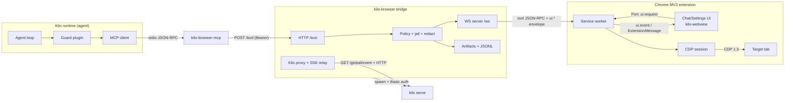
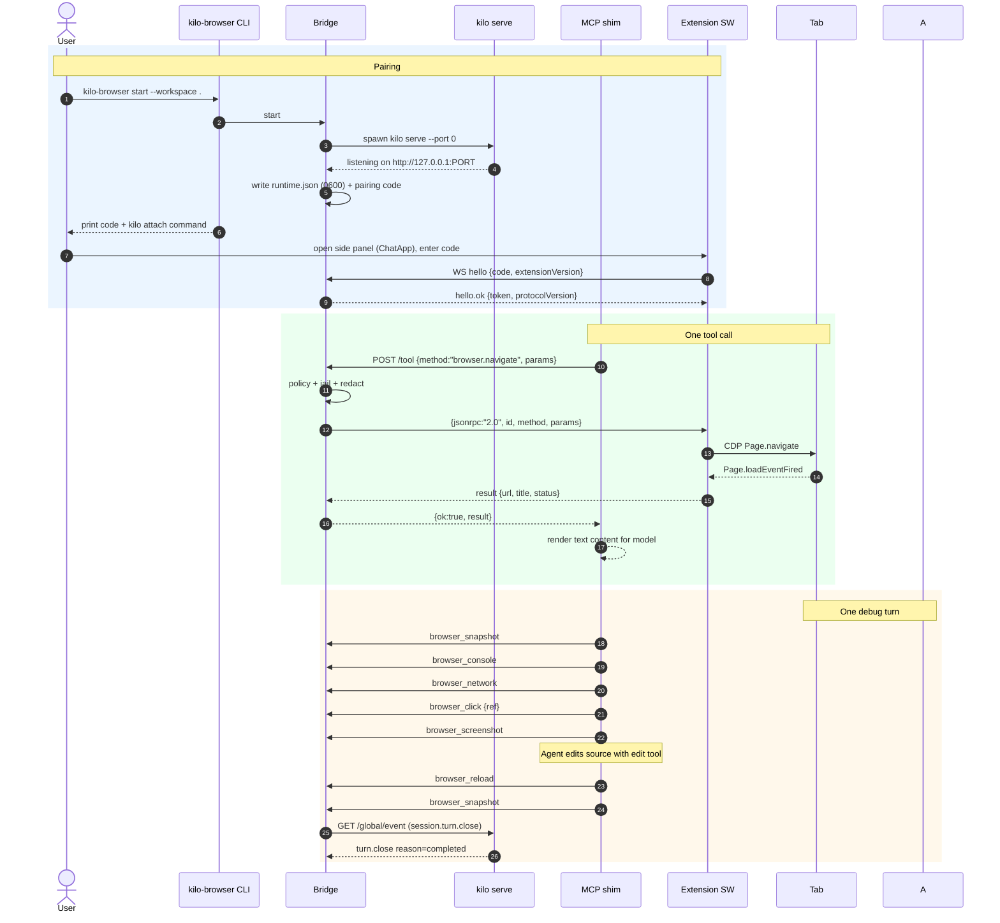

# Vấn đề người dùng và kiến trúc

> Thuộc [Kilo Browser Agent spec](./README.md) · Phần này chứa §3 và §7.

## 3. Vấn đề & người dùng

### 3.1 Problem statement

Khi một ứng dụng web chỉ tái hiện lỗi trong trình duyệt thật, agent phải đoán từ source và từ mô tả của người dùng. Kết quả điển hình là sửa nhiều lần, không có bằng chứng "đã hết lỗi", và người dùng phải tự sao chép console/network vào chat. Khoảng cách giữa "code đã đổi" và "hành vi đã đúng" không được đóng bởi bất kỳ tool nào hiện có: `read`/`grep` chỉ thấy file, `bash` không thấy DOM, còn MCP `chrome-devtools` bên thứ ba không có jail, không có policy, và không tích hợp permission của Kilo.

### 3.2 Jobs-to-be-done

| Job | Khi nào | Thành công trông như thế nào |
|---|---|---|
| Tái hiện lỗi | Người dùng nói "nút Save không lưu" | Agent mở đúng URL, thấy console error hoặc network 4xx/5xx tương ứng |
| Khoanh vùng nguyên nhân | Có nhiều nghi vấn | Agent trích được request/response, DOM node, stack trace, không cần người dùng copy tay |
| Sửa và xác minh | Đã có giả thuyết | Agent reload, lặp lại thao tác, chụp snapshot sau khi sửa và nêu bằng chứng |
| Ghi nhớ | Phiên sau | `MEMORY.md` chứa URL, tài khoản test (không chứa secret), selector bền, các bẫy đã gặp |
| Kiểm soát | Luôn luôn | Người dùng thấy và duyệt hành động nguy hiểm (eval, origin lạ, password warning); thao tác thường trong origin allowlist không cần duyệt; token không rời máy |

### 3.3 Persona

- **Solo dev**: chạy app ở `http://localhost:3000`, dùng Kilo CLI trong cùng repo, muốn agent tự bấm nút và đọc lỗi thay vì mô tả qua lại.
- **Dev trên staging**: app ở `https://staging.example.com`, cần đăng nhập bằng tài khoản test, cần giới hạn origin để agent không lang thang sang domain khác.
- **Reviewer**: nhận một session đã ghi, cần đọc lại artifact và log mà không cần chạy lại trình duyệt.

### 3.4 Why now

Kilo đã có `kilo serve` ổn định, SDK `/v2/client`, SSE có `session.turn.close`, MCP local stdio, permission có pattern map, và plugin hook `tool.execute.before`/`tool.execute.after`. Bốn mảnh ghép này đủ để dựng một bridge nhỏ mà không sửa shared opencode code. Việc để agent trong extension là bất khả thi vì MV3 service worker bị suspend và không có runtime Node; việc để extension gọi thẳng `kilo serve` thất bại vì CORS không cho `chrome-extension://` và sẽ lộ Basic password cho trang web nếu có lỗi.

## 7. Kiến trúc tổng thể

### 7.1 Thành phần và ranh giới trách nhiệm

| Thành phần | Trách nhiệm | Không làm |
|---|---|---|
| `kilo-browser` (bridge) | Preflight, spawn/supervise `kilo serve`, HTTP API cho shim, WS server cho extension, host RPC cho UI, policy/jail/redaction, artifact, JSONL log, SSE relay | Không chứa LLM, không render UI chat, không đọc source của người dùng |
| `kilo-webview` | Chat/settings components, contexts, hooks, i18n, styles, message types, `HostBridge` | Không gọi `vscode`/`chrome.*`, không giữ credential |
| Extension UI (sidepanel/settings) | Render `ChatApp`/`SettingsApp`, host adapter Port/storage/file/url | Không chứa LLM, không gọi trực tiếp `kilo serve` |
| `kilo-browser-mcp` (shim) | Đăng ký 12 MCP tool, chuyển JSON-RPC sang HTTP, map lỗi sang text cho model, trả image content | Không giữ token dài hạn, không nói chuyện trực tiếp với extension |
| Chrome extension (MV3) | Giữ phiên CDP trên một tab, chạy navigate/snapshot/screenshot/input/eval, ring buffer console/network, UI reuse + host adapter | Không chứa agent, không đọc filesystem, không gọi `kilo serve` |
| Guard plugin (Kilo) | Ép `ask` cho `browser_eval`, kiểm tra origin/path lần hai, redaction sau tool, chặn đọc runtime token | Không thay thế policy của bridge, không bảo vệ OS |
| Workspace `.kilo/kilo-browser/` | Config, memory, session notes, artifacts, logs, runtime token | Không commit secret; `runtime.json` bị gitignore |

### 7.2 Luồng dữ liệu

### 7.3 Sequence: pairing, một tool call, một debug turn

Ghi chú: trong sơ đồ trên, `A` (agent loop) nằm trong tiến trình Kilo; `M` là MCP client của Kilo gọi shim. Shim không bao giờ gọi trực tiếp `kilo serve`. Extension chỉ có một WS tới bridge; SW multiplex `ui.*` và `tool.*`, UI page chỉ nói chuyện với SW qua Port.

### 7.4 Quyết định kiến trúc (ADR-lite)

| Quyết định | Alternatives đã loại | Lý do | Hệ quả |
|---|---|---|---|
| Bridge local + MCP shim + extension CDP | Agent trong extension | MV3 SW bị suspend, không có Node/LLM runtime, không thể giữ tool loop ổn định; bundle LLM vào extension là bất khả thi về kích thước và credential | Phải có thêm một tiến trình và pairing |
| Extension chỉ nói chuyện với bridge qua WS loopback | Extension gọi trực tiếp `kilo serve` | CORS của server không allow `chrome-extension://`; Basic password sẽ nằm trong extension và có thể bị trang web đọc nếu XSS; mỗi lần đổi server phải sửa extension | Bridge là nơi duy nhất giữ credential Kilo |
| Dùng MCP tool thay vì plugin tool cho browser | Plugin thay MCP | Plugin tool không tự động được permission-gate; phải gọi `ctx.ask` thủ công; plugin tool không thêm được runtime nếu không reload instance; MCP cho phép cấu hình qua `mcp` map và Kilo namespacing `{server}_{tool}` (ra `browser_*`) | Phụ thuộc MCP shim và phải tự enforce policy trong shim |
| `chrome-devtools-mcp` chỉ dùng cho M0 spike | Dùng nó làm sản phẩm v1 | Không có jail, không có redaction theo policy của Kilo, không kiểm soát origin, không ghép được permission/ask; phù hợp để chứng minh CDP và localhost trong 1 ngày | M0 không cam kết cấu trúc protocol; v1 tự viết extension |
| Tái dùng UI qua `kilo-webview` + `HostBridge` | Custom UI; fork/copy `webview-ui`; alias source; `kilo-console` | Một UI, một i18n, một PermissionDock; tránh drift; `kilo-ui` vốn host-agnostic | Phải extract, codemod `useVSCode`→`useHost`, giữ visual regression xanh |
| UI ⇄ SW qua Port; SW giữ WS duy nhất | UI gọi trực tiếp bridge hoặc `kilo serve` | CORS/credential, MV3 SW sống độc lập, một bridge client, dễ backpressure | Phải định nghĩa envelope, id, channel `ui.*`/`tool.*` và resync |

---

[← Previous: Đặc tả: Kilo Browser Agent](./README.md) · [Next: Bridge](./02-bridge.md)
