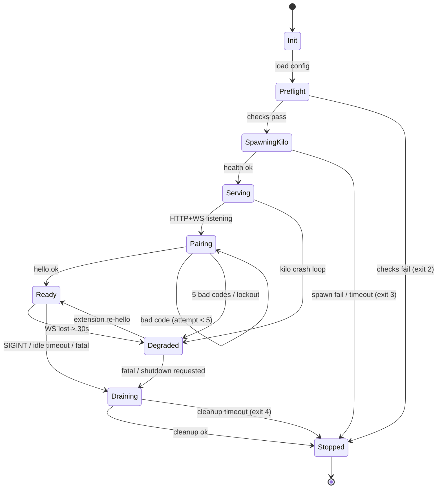

# Bridge

> Thuộc [Kilo Browser Agent spec](./README.md) · Phần này chứa §8, §8.1.

## 8. Thành phần

### 8.1 Bridge (`kilo-browser`)

#### 8.1.1 CLI flags

| Flag | Mặc định | Ý nghĩa |
|---|---|---|
| `--workspace <path>` | `process.cwd()` | Gốc jail và gốc `.kilo/kilo-browser/`; phải tồn tại và ghi được |
| `--host <host>` | `127.0.0.1` | Chỉ chấp nhận loopback; giá trị khác bị từ chối ở preflight |
| `--port <port>` | `0` | Port HTTP; WS dùng chung port qua upgrade tại `/ws` |
| `--kilo <path>` | `kilo` | Binary Kilo để spawn |
| `--kilo-url <url>` | rỗng | Bỏ qua spawn, dùng server có sẵn; cần `--kilo-password` |
| `--kilo-password <pw>` | rỗng | Password cho `--kilo-url`; không in ra log |
| `--no-spawn` | `false` | Alias của `--kilo-url` |
| `--pair-ttl <seconds>` | `120` | Thời gian sống của pairing code |
| `--idle-timeout <seconds>` | `1800` | Tự shutdown khi không có client và không có turn |
| `--log-level <level>` | `info` | `debug\|info\|warn\|error` |
| `--json` | `false` | In kết quả máy đọc được ra stdout |
| `--foreground` | `true` | v1 luôn chạy foreground; daemon hóa là future work |

#### 8.1.2 Preflight checks

1. `workspace` tồn tại, là directory, ghi được file tạm.
2. `.kilo/kilo-browser/` tạo được; trên POSIX đặt mode `0700`, trên Windows đặt ACL user-only best effort.
3. Không có bridge khác đang giữ `.kilo/kilo-browser/bridge.lock`; nếu có, đọc `runtime.json` và kiểm tra `GET /health`.
4. `kilo --version` chạy được trong 5 giây.
5. Port `--port` bind được; nếu `0`, lấy port tự do từ OS.
6. `kilo-browser.json` parse được và pass schema; sai schema thì dừng, không fallback im lặng.
7. Đủ dung lượng trống >= 100 MB cho artifacts.
8. Extension ID đã cấu hình hoặc đang ở pairing mode; nếu `allowedExtensionIds` rỗng thì bắt buộc pairing.
9. Không phải root/Administrator trên POSIX (cảnh báo, không chặn).
10. `git rev-parse --is-inside-work-tree` là tùy chọn; nếu không phải git, ghi cảnh báo rằng `external_directory` sẽ yếu hơn (worktree = `/`).

Preflight fail trả exit code `2` và JSON `{ok:false, code:"PREFLIGHT_FAILED", checks:[...]}`.

#### 8.1.3 Startup sequence

1. Parse flags, merge config theo thứ tự ưu tiên ở [mục 13](./08-config-observability.md).
2. Acquire lock; nếu fail, in bridge đang chạy và exit `0` (idempotent start).
3. Sinh `bridgeToken` 32 byte hex và `pairSecret` 32 byte hex; `pairCode` 6 chữ số từ `pairSecret`.
4. Sinh `.kilo/kilo.json` ([mục 13](./08-config-observability.md)) và `.kilo/plugins/kilo-browser-guard.ts` nếu chưa có; không ghi đè file người dùng đã sửa ([mục 13.5](./08-config-observability.md)). Config phải tồn tại trước khi `kilo serve` khởi động để MCP server `browser` được nạp ngay turn đầu.
5. Spawn `kilo serve --port 0 --hostname 127.0.0.1` với env `KILO_SERVER_PASSWORD`, `KILO_SERVER_USERNAME=kilo`, `KILO_PARENT_PID`, `KILO_CLIENT=kilo-browser` (giá trị mới; Kilo hiện chỉ xác nhận `vscode`, phần này `(chưa xác nhận)`), và `windowsHide: true`.
6. Đọc stdout đến khi gặp `kilo server listening on http://<host>:<port>`; timeout 20 giây; fallback poll `GET /global/health`.
7. Ghi `.kilo/kilo-browser/runtime.json` mode `0600` gồm `{httpUrl, wsUrl, token, kiloUrl, pid, startedAt, protocolVersion, bridgeVersion}`. Shim đọc lazy nên thứ tự này chịu được việc Kilo spawn MCP trước khi file tồn tại.
8. Khởi động HTTP server và WS upgrade trên cùng port.
9. In pairing code + lệnh attach:
   `kilo attach http://127.0.0.1:<port> --password <pw>`.
10. Chờ `hello.ok` từ extension; chuyển `Ready`. Trong lúc chờ, `browser_status` trả `NOT_PAIRED`.

Kilo Basic credential (`KILO_SERVER_PASSWORD`/`KILO_SERVER_USERNAME`) chỉ nằm trong memory/env của bridge; không bao giờ ghi vào `runtime.json`, log, hay gửi cho extension.

#### 8.1.4 Process supervision

- Theo dõi `kilo serve` bằng `exit` event và health poll mỗi 10 giây (timeout 3 giây).
- Nếu process thoát: ghi `kilo.exit`, thử restart tối đa 5 lần trong 60 giây với backoff 1s, 2s, 4s, 8s, 8s; sau đó chuyển `Degraded` và trả `KILO_UNAVAILABLE` cho tool call.
- Nếu health fail 3 lần liên tiếp nhưng process còn sống: coi là treo, gửi SIGTERM, chờ 5 giây, SIGKILL; restart theo cùng budget.
- Trên Windows dùng `taskkill /PID <pid> /T /F` cho cây process; trên POSIX kill process group.
- Khi bridge thoát, luôn kill cây `kilo serve` và xóa `runtime.json`.
- Không dùng `child_process` trực tiếp trên Windows: dùng wrapper `spawn` nội bộ của package có `windowsHide: true` ([mục 15.4](./10-delivery.md)).

#### 8.1.5 WS server

| Thuộc tính | Giá trị |
|---|---|
| Endpoint | `GET /ws` với `Upgrade: websocket` |
| Subprotocol | `kilo-browser.v1` (bắt buộc) |
| Origin | Phải là `chrome-extension://<id>` nằm trong `allowedExtensionIds`; integration test dùng `Origin: chrome-extension://kilotest` và ID này chỉ được thêm khi chạy test |
| Auth | Frame đầu tiên `hello` chứa `pairCode` hoặc `token`; không nhận query string token |
| Single client | Client thứ hai bị đóng với code `4001` và lý do `ALREADY_PAIRED` |
| Heartbeat | Bridge gửi `ping` mỗi 10 giây; không có `pong` trong 30 giây thì đóng `4003` |
| Frame limit | 8 MB; vượt thì đóng `4009` |
| Rate limit | 20 request/giây, burst 40; vượt trả `-32005` với `kind:"RATE_LIMIT"` |
| Close codes | `4000` normal, `4001` already paired, `4002` unsupported version, `4003` heartbeat timeout, `4004` unauthorized, `4009` message too big |

Frame đầu tiên:

```json
{"jsonrpc":"2.0","id":1,"method":"hello","params":{"protocolVersion":"1.0","bridgeToken":"<optional>","pairCode":"123456","extensionVersion":"0.1.0","extensionId":"<chrome id>"}}
```

Phản hồi:

```json
{"jsonrpc":"2.0","id":1,"result":{"ok":true,"protocolVersion":"1.0","bridgeVersion":"0.1.0","token":"<64 hex>","heartbeatMs":10000}}
```

Sai code 5 lần trong 120 giây: đóng `4004`, khóa pairing 60 giây, ghi `pair.lockout`.

#### 8.1.6 HTTP API

Tất cả yêu cầu có `Authorization: Bearer <bridgeToken>` trừ `GET /health` (chỉ trả metadata không nhạy cảm). Nội dung JSON, tối đa 8 MB.

`POST /tool`:

```json
{"method":"browser.navigate","params":{"url":"http://localhost:3000/login"},"requestId":"req_01","sessionID":"ses_x","callID":"call_y","timeoutMs":15000}
```

Thành công:

```json
{"ok":true,"result":{"url":"http://localhost:3000/login","title":"Login","status":200,"durationMs":412}}
```

Thất bại:

```json
{"ok":false,"error":{"code":-32006,"kind":"NETWORK_REFUSED","message":"net::ERR_CONNECTION_REFUSED","retryable":true,"remediation":"Kiểm tra app có đang chạy ở cổng 3000 không."}}
```

`GET /health`:

```json
{"ok":true,"bridgeVersion":"0.1.0","protocolVersion":"1.0","paired":true,"pairingOpen":false,"tab":{"id":123,"url":"http://localhost:3000/","title":"App"},"kilo":{"url":"http://127.0.0.1:51234","healthy":true},"uptimeMs":8421}
```

`GET /events` (tùy chọn, SSE): bridge phát `bridge.event` cho các sự kiện nội bộ quan trọng (`pair.ok`, `tab.attached`, `policy.deny`, `loop.stop`). Đây là kênh debug, không phải nguồn sự thật cho agent.

#### 8.1.7 Kilo proxy endpoints

| Endpoint | Method | Body | Mục đích |
|---|---|---|---|
| `/kilo/status` | GET | - | Trả `session.status` đã chuẩn hóa cho `sessionID` |
| `/kilo/abort` | POST | `{sessionID, scope:"session"\|"tree"}` | Proxy `POST /session/:id/abort?scope=` |
| `/kilo/permissions` | GET | - | Proxy `GET /permission?directory=` |
| `/kilo/permissions/:requestID/reply` | POST | `{reply, message?, interactive?}` | Proxy `POST /permission/:requestID/reply` |
| `/kilo/sessions` | POST | `{title?, parentID?}` | Tạo session qua SDK |
| `/kilo/prompt` | POST | `{sessionID, parts, model?, agent?}` | Proxy `POST /session/:id/message` (blocking) |
| `/kilo/prompt_async` | POST | như trên | Proxy `POST /session/:id/prompt_async` (204) |

Bridge giữ Basic credential của `kilo serve`; extension và shim không bao giờ thấy nó. Các endpoint này chỉ mở cho Bearer token của bridge.

#### 8.1.8 SSE relay

- Frame SSE: `event: message`, `data: {id, type, properties}`; global stream thêm `directory`, `project?`, `workspace?`, `payload`. Instance stream là `GET /event`, global là `GET /global/event`.
- Bridge mở `GET <kiloUrl>/global/event` với Basic auth và `?auth_token=<base64(user:pass)>` nếu EventSource không set được header.
- Reconnect khi đóng: backoff 250ms → 8s, jitter ±20%, tối đa 10 lần; sau đó `kilo.sse.down`.
- Giữ ring 100 event gần nhất; phát hiện gap bằng `id` tăng dần và ghi `sse.gap`.
- Chuyển tiếp cho `ui.*`: `permission.asked`, `permission.replied`, `session.turn.close`, `session.status`, `session.diff`, `message.part.delta`; `tool.*` không nhận delta để tránh nhiễu.
- `session.turn.close` là tín hiệu kết thúc turn; `session.status` idle là fallback nếu thiếu `turn.close` trong 2 giây. `session.idle` là deprecated, không dùng.

#### 8.1.9 Shutdown sequence

1. Ngừng nhận HTTP mới (`503 SHUTTING_DOWN`).
2. Gửi close frame `1001` tới extension, chờ 2 giây.
3. Hủy mọi tool call đang chạy; ghi `tool.cancel`.
4. Flush JSONL, đóng artifact đang mở.
5. SIGTERM `kilo serve`, chờ 5 giây, SIGKILL cây process.
6. Xóa `runtime.json`, release lock.
7. Exit `0`; nếu bất kỳ bước nào quá 10 giây, exit `4` và để lại `logs/shutdown-failure.json`.

#### 8.1.10 State machine



Failure exits: mọi trạng thái trước `Ready` đều có đường tới `Stopped`; `Degraded` vẫn phục vụ `browser_status` và trả lỗi có `retryable` cho tool khác. Không có trạng thái treo không thoát: mọi chờ đều có timeout.

---

[← Previous: Vấn đề người dùng và kiến trúc](./01-architecture.md) · [Next: MCP shim và protocol](./03-protocol-mcp.md)
