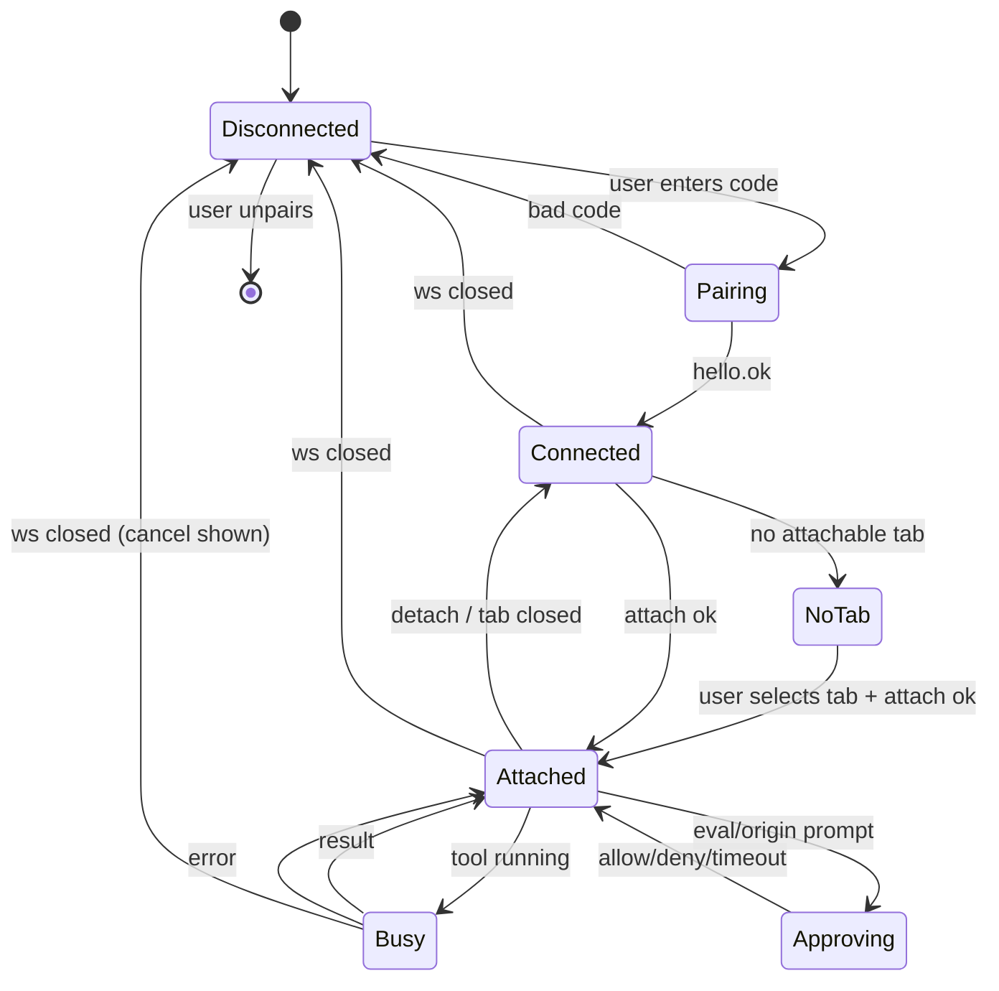

# Chrome extension (MV3)

> Thuộc [Kilo Browser Agent spec](./README.md) · Phần này chứa §8.3.

### 8.3 Chrome extension (MV3)

#### 8.3.1 `manifest.json`

```json
{
  "manifest_version": 3,
  "name": "Kilo Browser Bridge",
  "description": "Local-only CDP bridge for Kilo Browser Agent",
  "version": "0.1.0",
  "minimum_chrome_version": "116",
  "permissions": ["debugger", "storage", "sidePanel", "tabs", "alarms"],
  "host_permissions": ["http://localhost/*", "http://127.0.0.1/*"],
  "optional_host_permissions": ["https://*/*", "http://*/*"],
  "background": {"service_worker": "service-worker.js", "type": "module"},
  "action": {"default_title": "Kilo Browser"},
  "side_panel": {"default_path": "sidepanel.html"},
  "options_ui": {"page": "settings.html", "open_in_tab": true},
  "content_security_policy": {"extension_pages": "script-src 'self' 'wasm-unsafe-eval'; object-src 'none'; worker-src 'self'; connect-src 'self' ws://127.0.0.1:* http://127.0.0.1:*; img-src 'self' data: blob:; font-src 'self' data:; style-src 'self' 'unsafe-inline'"}
}
```

Không có `web_accessible_resources`, không load script từ CDN, không dùng `eval` trong extension. Quyền `<all_urls>` không được yêu cầu mặc định; origin lạ phải xin qua `optional_host_permissions` và được người dùng duyệt.

#### 8.3.2 Extension modules

| Module | Trách nhiệm |
|---|---|
| `background/service-worker.ts` | Vòng đời SW, khôi phục state sau suspend, khởi động WS |
| `transport/ws.ts` | Kết nối `ws://127.0.0.1:<port>/ws`, hello, reconnect, heartbeat |
| `rpc/router.ts` | Dispatch JSON-RPC, cancel, idempotency cache |
| `cdp/session.ts` | Attach/detach, theo dõi `chrome.debugger.onDetach`, map tab |
| `cdp/domains/page.ts` | `Page.navigate`, `Page.reload`, `Page.getFrameTree` |
| `cdp/domains/runtime.ts` | `Runtime.evaluate`, `Runtime.consoleAPICalled`, exception |
| `cdp/domains/network.ts` | `Network.enable`, request/response, failure |
| `cdp/domains/dom.ts` | `DOM.getDocument`, `DOM.resolveNode`, accessibility tree |
| `cdp/domains/input.ts` | `Input.dispatchMouseEvent`, `Input.dispatchKeyEvent` |
| `tools/*.ts` | Một file cho mỗi tool, validate params, gọi CDP, format result |
| `refs/registry.ts` | Sinh ref, map ref → backendNodeId, TTL |
| `buffers/ring.ts` | Ring buffer console/network, truncate body |
| `storage/store.ts` | Schema `chrome.storage.local`, migration |
| `ui/bootstrap.ts` | Set `window.KILO_*` rồi dynamic import; không inline script |
| `ui/sidepanel.tsx` | `ChatApp` + `BrowserHostBridge`, Port `kilo-ui` |
| `ui/settings.tsx` | `SettingsApp` tab/side panel |
| `ui/host.ts` | Port envelope, capabilities, storage, clipboard, file/url |

#### 8.3.3 CDP domains và attach lifecycle

| Domain | Dùng cho | Ghi chú |
|---|---|---|
| `Page` | navigate, reload, lifecycle events | Bật `Page.enable` sau attach |
| `Runtime` | eval, console, exception | `Runtime.enable`; không bật `Runtime.evaluate` cho page context nếu policy deny |
| `DOM` | snapshot, resolve ref | `DOM.enable`, `DOM.getDocument({depth:-1,pierce:true})` |
| `Accessibility` | tên/role cho snapshot | `Accessibility.getFullAXTree` |
| `Network` | request/response/failure | `Network.enable`; giới hạn body 32 KB/entry |
| `Log` | browser log entry | Bổ sung cho `Runtime.consoleAPICalled` |
| `Input` | click, type, press | Toạ độ lấy từ `DOM.getBoxModel` |
| `Emulation` | viewport cố định cho screenshot | `Emulation.setDeviceMetricsOverride` tùy chọn |

Attach lifecycle:

1. Mặc định auto-attach: SW lấy tab đang active (`chrome.tabs.query({active:true,lastFocusedWindow:true})`), bỏ qua trang nội bộ (`chrome://`, `chrome-extension://`, `devtools://`), rồi attach và lưu `tabId`, `windowId`. SW theo `chrome.tabs.onActivated` để đổi tab. Người dùng vẫn có thể chọn tab thủ công trong side panel; đặt `autoAttach:false` trong storage để tắt auto-attach.
2. Gọi `chrome.debugger.attach({tabId}, "1.3")`.
3. Nếu lỗi `Another debugger is already attached`: hiển thị "Đóng DevTools của tab này rồi thử lại"; trả `-32006` kind `DEVTOOLS_CONFLICT`.
4. Bật các domain theo bảng; đăng ký listener `onEvent`, `onDetach`.
5. Khi tab đóng hoặc `onDetach`: detach sạch, xóa ref, đặt `tab=null`, trả `-32003` cho call kế tiếp.
6. Trước mỗi tool call, xác minh `chrome.debugger.getTargets()` còn target `attached:true`; nếu không, thử attach lại một lần.

#### 8.3.4 Sinh ref

1. Lấy accessibility tree và DOM tree; duyệt theo thứ tự document.
2. Chỉ cấp ref cho node có `role` hoặc `name`, hoặc là input/button/link có `backendNodeId`.
3. Chuẩn hóa tên: trim, gộp whitespace, bỏ ký tự điều khiển; hash `sha256(role + "\u0000" + name + "\u0000" + tag + "\u0000" + ordinal)` lấy 8 hex.
4. Ref hiển thị là `e<index>` theo thứ tự snapshot; map `eN → {backendNodeId, frameId, hash, snapshotId}`.
5. Ref chỉ sống trong `snapshotId` hiện tại; snapshot mới tăng `generation`, ref cũ trả `-32004 STALE_REF`.
6. `browser_click` chấp nhận `ref` hoặc `selector`; nếu cả hai có, `ref` thắng và `selector` bị bỏ qua.
7. Không cấp ref cho node trong iframe cross-origin không truy cập được; ghi `skippedFrames` trong kết quả.

#### 8.3.5 Ring buffers

| Buffer | Số entry | Bytes/entry | Tổng cap | Hành vi khi đầy |
|---|---|---|---|---|
| Console | 500 | 8 KB | 4 MB | Ghi đè cũ nhất; tăng `dropped` |
| Network | 200 | 32 KB body | 6 MB | Bỏ body trước, giữ metadata; tăng `bodyDropped` |
| CDP events | 1000 | 2 KB | 2 MB | Chỉ giữ event quan trọng; tăng `eventsDropped` |
| Artifacts metadata | 200 | 1 KB | 200 KB | Ghi đè cũ nhất |

Mỗi entry có `seq` tăng đơn điệu để agent biết đã bỏ lỡ dữ liệu. `browser_console`/`browser_network` trả `dropped` và `oldestSeq`.

#### 8.3.6 Storage schema (`chrome.storage.local`)

```json
{
  "schemaVersion": 1,
  "settings": {"bridgePort": null, "autoReconnect": true, "redactInUi": true},
  "pairing": {"extensionId": "<id>", "token": "<64 hex>", "bridgeUrl": "ws://127.0.0.1:PORT/ws", "pairedAt": "2026-11-19T00:00:00Z"},
  "allowlist": {"origins": ["http://localhost:3000", "https://staging.example.com"]},
  "tab": {"tabId": 123, "windowId": 1},
  "ui": {"panelOpen": true, "pageMode": "sidepanel", "theme": "kilo", "lastError": null}
}
```

Token lưu dạng plaintext trong `chrome.storage.local` (không có secure enclave cho extension); đây là rủi ro được chấp nhận và giảm thiểu bằng TTL theo phiên bridge + revoke. Không lưu password Kilo, không lưu cookie.

#### 8.3.7 Reconnect và keepalive

- SW bị suspend: dùng `chrome.alarms` 30 giây để đánh thức và kiểm tra WS; không dựa vào timer trong SW.
- Khi WS đóng: backoff 250ms, 500ms, 1s, 2s, 4s, 8s (tối đa 8s), jitter ±20%, tối đa 10 lần; sau đó hiện "Mất kết nối" và nút Pair lại.
- Heartbeat: trả lời `ping` bằng `pong` trong 2 giây; nếu bridge không ping trong 30 giây, chủ động đóng và reconnect.
- Khi reconnect, gửi `hello` với token đã lưu; nếu `4004`, xóa token và yêu cầu pair lại.
- Không tự attach lại tab sau khi user đóng tab; phải chọn lại.

#### 8.3.8 UI host state machine



Failure exits: `Pairing` timeout 120 giây → `Disconnected`; `Approving` timeout 60 giây → deny; `Busy` quá timeout tool + 5 giây → hiện Cancel và trả `-32005` kind `BUSY`.

UI pages:

- `sidepanel.html`: `ChatApp` (chat, session tabs, `PermissionDock`/`QuestionDock`, pairing gate).
- `settings.html`: `SettingsApp` (models, providers, autoApprove, agentBehaviour, display, language, about bản browser).
- Không còn panel tối giản riêng; trạng thái tab/CDP vẫn tách khỏi trạng thái UI và hiển thị qua capability.

#### 8.3.9 Pairing flow

1. Bridge in ra `pairCode` 6 chữ số và `pairSecret` (không in secret).
2. Người dùng mở side panel (`ChatApp`), nhập code trong pairing gate.
3. Extension gửi `hello {pairCode, extensionId, extensionVersion, protocolVersion}`.
4. Bridge kiểm tra TTL, số lần sai, và `extensionId` (nếu allowlist không rỗng).
5. Bridge trả `token` 64 hex, gắn token với `extensionId` + `tabId` hiện tại; đóng mọi client cũ.
6. Extension lưu token, chuyển `Connected`.
7. Token bị thu hồi khi bridge restart, khi người dùng bấm "Pair again", hoặc khi `kilo-browser pair --rotate`.

Đường pre-approved (không cần code): nếu `extensionId` nằm trong `browser.allowedExtensionIds`, bridge bỏ yêu cầu `pairCode`. `/pair/hint` trả thêm `autoPair:true` để UI hiện nút **Connect** thay vì ô code, và `/pair/claim` chấp nhận claim không có `pairCode` (WS `hello` cũng vậy). Boundary vẫn giữ: chỉ đúng extension id đó nhận được token hiện hành, và token vẫn bắt buộc cho mọi call `/tool`.

#### 8.3.10 PermissionDock và approval

- UI dùng `PermissionDock` và `QuestionDock` từ `kilo-webview`, không dựng modal riêng.
- Kích hoạt cho `browser_eval` (khi policy là `ask`), cho origin ngoài allowlist, và cho cảnh báo password-field. Không approval cho `navigate`/`click`/`type`/`press`/`reload` thông thường trong origin đã allowlist.
- Nội dung: method, origin, preview tham số tối đa 500 ký tự đã redact, thời gian hết hạn.
- `Allow once` chỉ áp dụng cho một call; `Allow for tab` áp dụng đến khi đổi tab hoặc 15 phút.
- Timeout 60 giây → deny, trả `-32001` kind `APPROVAL_TIMEOUT` (không retry tự động).
- Round-trip: UI post `permissionResponse` → SW → bridge → `POST /permission/:requestID/reply`; kết quả phát lại qua `permission.replied`.

#### 8.3.11 Error mapping sang thông báo hành động được

| Tình huống | UI text | Hành động |
|---|---|---|
| `DEVTOOLS_CONFLICT` | "DevTools đang mở trên tab này." | Đóng DevTools rồi bấm Retry |
| `NO_TARGET` | "Chưa chọn tab hoặc tab đã đóng." | Chọn tab trong danh sách |
| `NOT_PAIRED` | "Extension chưa pair với bridge." | Nhập code hoặc chạy `kilo-browser pair` |
| `UNAUTHORIZED` | "Token không còn hợp lệ." | Bấm "Pair again" |
| `POLICY_DENIED` | "Origin này không nằm trong allowlist." | Thêm origin trong Settings hoặc dùng localhost |
| `NETWORK_REFUSED` | "Không kết nối được tới URL." | Kiểm tra app đang chạy và đúng port |
| `STALE_REF` | "Trang đã thay đổi từ snapshot trước." | Agent gọi `browser_snapshot` lại |

---

[← Previous: MCP shim và protocol](./03-protocol-mcp.md) · [Next: Tool reference và debug loop](./05-tools-loop.md)
