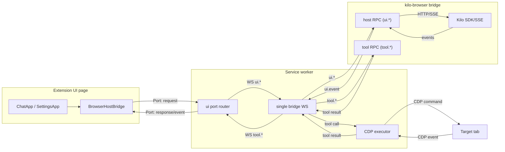

# UI reuse: Kilo webview trong extension

> Thuộc [Kilo Browser Agent spec](./README.md) · Phần này chứa §22.

## 22. UI reuse: Kilo webview trong extension

### 22.1 Mục tiêu & phạm vi UI v1

Extension **không** dựng panel tối giản riêng. Chat và Settings của Kilo được tái dùng qua package `kilo-webview`; extension chỉ cung cấp host adapter (Port, storage, file/url actions) và vỏ MV3. Mục tiêu là cùng một UI, cùng component, cùng i18n và cùng hành vi permission với VS Code, không fork giao diện.

Feature matrix:

| Surface | v1 | Host dependency | Fallback khi thiếu |
|---|---|---|---|
| Chat / New task | có | session create + prompt qua bridge | ẩn nút gửi, hiện lỗi bridge |
| Session tabs | có | `GET /session`, `GET /session/:id/message` | chỉ session hiện tại |
| Local history | có | sessions list + index `chrome.storage.local` | empty state |
| Local profile/login (gateway models) | có | gateway auth/provider qua bridge | ẩn profile, dùng provider local |
| Settings / models | có | config + provider list | read-only |
| Settings / providers | có | provider auth/config | ẩn nút connect |
| Settings / autoApprove | có | permission config | ẩn tab |
| Settings / agentBehaviour | có | agents, MCP, rules, skills map vào config | ẩn mục không map được |
| Settings / display | có | browser prefs | default |
| Settings / language | có | i18n bundle | `en` |
| Settings / about (browser variant) | có | version + capabilities | text tối thiểu |
| Agent Manager | không | worktree/git/terminal | ẩn |
| Marketplace | không | marketplace backend | ẩn |
| Migration | không | VS Code storage | ẩn |
| Terminal / worktrees / PR | không | VS Code host | ẩn |
| Cloud sessions / remote / caffeination | không | cloud host | ẩn |
| Indexing / sandboxing / autocomplete / speech-to-text | không | VS Code host | ẩn |
| Browser-tab surface | không | VS Code browser tab | ẩn |
| Checkpoints | không (v1) | snapshot host | ẩn; xem Phụ lục C |

Quy tắc: mọi surface không có trong bảng “có” phải bị ẩn bởi capability flag, không render nút chết. Không dùng CSS để che; không render component nếu capability false.

### 22.2 Quyết định tái dùng + alternatives đã loại

Quyết định: extract `packages/kilo-webview` từ `packages/kilo-vscode/webview-ui`, dùng chung cho VS Code và extension. Extension cung cấp `BrowserHostBridge`; VS Code cung cấp `VSCodeProvider` hiện có.

| Phương án | Kết luận | Lý do |
|---|---|---|
| Tái dùng qua `kilo-webview` + host adapter | chọn | Một UI, một i18n, một bộ component; bug fix một nơi |
| Custom UI tối giản | loại | Drift với chat/settings thật; thiếu PermissionDock/QuestionDock; chi phí duy trì cao |
| Copy/fork `webview-ui` | loại | Hai bản fork, sửa lệch, không có parity gate |
| Alias source trực tiếp, không extract | loại | `kilo-vscode` build coupling, VS Code API rò vào extension, không có boundary để test |
| Dùng `kilo-console` | loại | SPA cũ, chỉ là tham chiếu transport/build; không có chat transcript |
| Iframe/remote UI | loại | CSP, auth, latency; không giải quyết host adapter |

### 22.3 Package boundary

```text
packages/kilo-webview/   # @kilocode/kilo-webview (private)
  package.json
  tsconfig.json
  src/
    components/
    context/          # trừ vscode.tsx
    hooks/
    i18n/
    styles/
    types/messages/
    utils/
    host/HostBridge.ts
    apps/ChatApp.tsx
    apps/SettingsApp.tsx
    index.ts
```

| Phần | Đi đâu |
|---|---|
| `components`, `context` portable (trừ `vscode.tsx`; `provider-base.tsx` chỉ chuyển sau khi bỏ import `VSCodeProvider`), `hooks`, `i18n`, `styles`, `types/messages`, portable `utils` | `kilo-webview` |
| `App.tsx`, entry files, `VSCodeProvider`, DataBridge, VS Code-only utils | giữ `kilo-vscode/webview-ui` |
| Chat/settings composition cho browser | `kilo-browser/extension/ui` gọi `ChatApp`/`SettingsApp` |

Import rules:

| Từ | Được import | Không được import |
|---|---|---|
| `kilo-webview` | React/Solid, `kilo-ui`, types nội bộ | `vscode`, `kilo-vscode`, `chrome.*`, `acquireVsCodeApi` |
| `kilo-vscode/webview-ui` | `@kilocode/kilo-webview`, `VSCodeProvider` | ngược lại từ shared |
| `kilo-browser/extension/ui` | `@kilocode/kilo-webview`, `BrowserHostBridge` | `kilo-vscode`, `vscode` |

`provider-base.tsx` hiện import `VSCodeProvider`; giữ ở `kilo-vscode` hoặc refactor sang `useHost` trước khi chuyển. Codemod: `useVSCode()` → `useHost()` trong toàn bộ shared package (khoảng 70 call site đã kiểm chứng trong `webview-ui`). Codemod cơ học, không đổi hành vi; điều kiện pass là typecheck + visual regression + unit test của `kilo-vscode` xanh.

`HostBridge` interface:

```ts
export type HostCapability =
  | "chat" | "sessions" | "history" | "profile" | "settings"
  | "settings.models" | "settings.providers" | "settings.autoApprove"
  | "settings.agentBehaviour" | "settings.display" | "settings.language"
  | "settings.about" | "permissions" | "questions" | "file.open"
  | "file.diff" | "url.open" | "files.validate" | "clipboard";

export interface HostCapabilities extends Record<HostCapability, boolean> {}

export interface HostBridge {
  readonly kind: "vscode" | "browser";
  readonly capabilities: HostCapabilities;
  post(message: WebviewMessage): void;
  subscribe(listener: (message: ExtensionMessage) => void): () => void;
  getState<T>(): T | undefined;
  setState<T>(state: T): void;
  sidebarSide(): "left" | "right" | undefined;
  active(): boolean;
  clipboard: { readText(): Promise<string>; writeText(text: string): Promise<void> };
  openExternal(url: string): Promise<void>;
  openFile(path: string): Promise<void>;
  openDiff(input: { path: string; before: string; after: string }): Promise<void>;
  validateFiles(paths: string[]): Promise<{ ok: string[]; denied: { path: string; reason: string }[] }>;
}
```

Provider stack: `HostProvider` (adapter) → `ThemeProvider defaultTheme="kilo"` → `I18nProvider` → `DataBridge` (host-specific) → `ChatApp` hoặc `SettingsApp`. `kilo-vscode` và `kilo-browser` khai báo dependency workspace `@kilocode/kilo-webview`.

### 22.4 Browser host adapter

UI page ⇄ service worker qua `chrome.runtime.connect({ name: "kilo-ui" })`. SW ⇄ bridge qua đúng một WebSocket đã pair; UI không bao giờ gọi `kilo serve` trực tiếp.



Port envelope:

```ts
type UiRequest  = { v: 1; id: string; kind: "request"; method: string; params?: unknown };
type UiResponse = { v: 1; id: string; kind: "response"; ok: boolean; result?: unknown; error?: { code: string; message: string } };
type UiEvent    = { v: 1; id: string; kind: "event"; event: string; payload: unknown };
```

| Thành phần | Quy tắc |
|---|---|
| Channel | `ui.*` cho chat/settings/approval; `tool.*` cho tool call của MCP/bridge |
| Correlation | `id` do UI sinh; SW trả đúng `id`; event có `id` riêng |
| Backpressure | high-water 1 MB hoặc 256 message; vượt thì pause event không critical, coalesce delta |
| Reconnect | UI reconnect Port khi `visibilitychange`; gửi `ui.hello {lastSeq}` |
| Suspend | SW giữ state trong `chrome.storage.session`; UI resync sessions/messages khi mở lại |
| Auth | Port chỉ chấp nhận `sender.id === chrome.runtime.id`; bridge chỉ chấp nhận token đã pair |
| Single client | Một SW giữ một WS; nhiều page dùng chung Port |

### 22.5 Host RPC mapping

Bảng dưới map nhóm `WebviewMessage` sang bridge handler. Chỉ dùng route/event đã có trong spec; chỗ chưa xác minh ghi `(chưa xác nhận)`.

| Nhóm WebviewMessage | Bridge handler | SDK/config action | Ghi chú |
|---|---|---|---|
| `webviewReady`, `ui.hello` | `ui.hello` | trả capabilities + config snapshot | Không trả token |
| `sendMessage`, `newSession` | `ui.session.prompt` | `POST /session`, `POST /session/:id/message` hoặc `prompt_async` | Streaming qua SSE |
| `abort` | `ui.session.abort` | `POST /session/:id/abort?scope=session\|tree` | Trả `session.turn.close` |
| `loadSessions`, `switchSession` | `ui.session.list` | `GET /session`, `GET /session/:id/message` | Phân trang client-side |
| `deleteSession` | `ui.session.delete` | route xóa session `(chưa xác nhận)` | Ẩn nếu capability false |
| `permissionResponse` | `ui.permission.reply` | `POST /permission/:requestID/reply` | `PermissionDock` |
| `questionResponse` | `ui.question.reply` | route question `(chưa xác nhận)` | `QuestionDock` |
| `updateConfig`, settings tabs | `ui.config.write` | ghi `.kilo/kilo.json` / global config qua bridge | Không ghi secret vào log |
| `requestProviders`, models | `ui.providers.list` | provider list/config `(chưa xác nhận)` | Fallback read-only |
| MCP add/toggle | `ui.mcp.update` | `POST /mcp` + config file | Chỉ server local/remote đã hỗ trợ |
| History | `ui.history.list` | sessions + index local | Không đồng bộ cloud |
| Profile/login | `ui.profile.*` | gateway auth `(chưa xác nhận)` | Token chỉ trong SW memory/local |
| `openFile` | `ui.file.open` | bridge đọc file trong jail | Read-only viewer tab |
| `openDiff` | `ui.file.diff` | bridge đọc before/after | Diff tab dùng `kilo-ui` |
| `openExternal` | `ui.url.open` | `chrome.tabs.create` | Chỉ `http:`/`https:` |
| `validateFiles` | `ui.files.validate` | bridge jail | Trả danh sách denied |
| Clipboard | `ui.clipboard.*` | `navigator.clipboard` | Cần user gesture |

`ExtensionMessage` producers từ SSE:

| SSE event | ExtensionMessage | UI consumer |
|---|---|---|
| `session.turn.close` | turn completed/error/interrupted | ChatView, composer |
| `session.status` | busy/idle | ChatView, status bar |
| `message.part.delta` | streaming part delta | MessageList |
| `permission.asked` | permission request | PermissionDock |
| `permission.replied` | permission resolved | PermissionDock |
| `session.diff` | file diff summary | Diff/History |
| `server.connected` / `server.heartbeat` | connection state | Banner |

Message không hỗ trợ: bridge trả `ui.error` với `code:"HOST_UNSUPPORTED"`; UI ẩn surface bằng capability, không hiện nút chết. Không silent no-op cho hành động có side effect.

### 22.6 Settings persistence & precedence

| Loại setting | Nơi lưu | Ghi bởi | Ví dụ |
|---|---|---|---|
| Kilo project config | `.kilo/kilo.json` | bridge | models, providers, autoApprove, agents, MCP |
| Kilo global config | global Kilo config | bridge | provider mặc định, theme mặc định |
| Browser host prefs | `chrome.storage.local` | UI host adapter | theme, page mode, sidebar side, last session |
| Ephemeral UI state | `chrome.storage.session` | UI | dialog mở, scroll, draft ngắn hạn |
| Secrets | SW memory + storage có TTL | SW | gateway session token; không vào log/artifact |

Precedence: project Kilo config > global Kilo config > browser prefs (chỉ display) > default. Browser prefs không ghi đè config Kilo; settings tabs đọc/ghi qua bridge.

Migration VS Code-only:

| VS Code setting | Browser |
|---|---|
| theme / font size | `chrome.storage.local`, `ThemeProvider` |
| sidebar side | side panel/ tab; fallback tab |
| terminal, checkpoints, autocomplete | ẩn, không migrate |
| Agent Manager, marketplace, migration | ẩn |
| provider login | đăng nhập lại qua gateway/profile |

### 22.7 Build & packaging

Vite (`vite-plugin-solid`, `base:"./"`):

```ts
export default defineConfig({
  base: "./",
  plugins: [solid()],
  build: {
    target: "chrome116",
    rollupOptions: {
      input: { sidepanel: "ui/sidepanel.html", settings: "ui/settings.html" },
      output: {
        entryFileNames: "assets/[name]-[hash].js",
        assetFileNames: "assets/[name]-[hash][extname]",
      },
    },
  },
  worker: { format: "es" },
})
```

- `ui/bootstrap.ts` set `window.KILO_CAPABILITIES`, `window.KILO_ASSET_BASE` (không token, không bridge URL), rồi `import("./main")`. Không inline script.
- Manifest CSP chính xác:

```text
script-src 'self' 'wasm-unsafe-eval'; object-src 'none'; worker-src 'self'; connect-src 'self' ws://127.0.0.1:* http://127.0.0.1:*; img-src 'self' data: blob:; font-src 'self' data:; style-src 'self' 'unsafe-inline'
```

- Manifest delta: `options_ui` trỏ `settings.html`; `side_panel.default_path` trỏ `sidepanel.html`; không `web_accessible_resources` cho asset nội bộ; worker và WASM load bằng `chrome.runtime.getURL`.
- Fonts/icons: bundle local; runtime path qua `chrome.runtime.getURL`; không CDN.
- Hai page dùng cùng bundle shared; settings mở như tab hoặc side panel.

### 22.8 Theme & rendering

- `ThemeProvider defaultTheme="kilo"`; mode `light|dark|system`; theme id `kilo` đã có trong `kilo-ui`.
- Không phụ thuộc `--vscode-*`; token CSS của `kilo-webview` có fallback; extension không inject VS Code vars.
- Fonts bundle + fallback system; icon qua sprite/asset local.
- Shiki: worker + WASM asset; CSP có `wasm-unsafe-eval` và `worker-src 'self'`; code/diff dùng component shared, không renderer riêng.
- Không dùng `eval`, không remote script; mọi asset qua `chrome.runtime.getURL`.

### 22.9 Browser equivalents cho host-only actions

| Host action | Browser | Loại |
|---|---|---|
| `openFile` | read-only viewer tab, bridge đọc trong jail | read-only |
| `openDiff` | diff tab dùng `kilo-ui` | read-only |
| `openExternal` | `chrome.tabs.create`, chỉ http/https | supported |
| `validateFiles` | bridge jail | supported |
| clipboard | `navigator.clipboard` | supported |
| reveal in explorer / terminal | không có | unsupported |
| worktree / PR / cloud session | không có | unsupported |
| notifications | `chrome.notifications` (optional) | supported nếu permission |

### 22.10 Testing & parity gates

| Gate | Cách chạy | Điều kiện pass |
|---|---|---|
| VS Code visual regression | `bun run test:visual` trong `kilo-vscode` | Snapshot không đổi sau extraction |
| VS Code unit + typecheck | `bun run test:unit`, `bun run typecheck` | Xanh, `knip` sạch |
| Shared import audit | script grep/ESLint | `kilo-webview` không import `vscode`/`chrome` |
| Extension UI E2E | `bun run test:ui` | Chat stream, settings save, PermissionDock |
| CSP/asset smoke | Playwright mở sidepanel/settings | 0 CSP violation, Shiki worker load |
| Bundle budget | `bun run build:ui` | Chat <= 4.5 MB gzip, settings <= 3.0 MB gzip (điều chỉnh có chủ đích) |
| Message drift | typecheck shared union | Không breaking change ngoài version |

### 22.11 Risks & mitigations

| Risk | Likelihood | Impact | Mitigation | Early warning |
|---|---|---|---|---|
| Extraction làm hỏng VS Code UI | Trung bình | Cao | Codemod + visual regression + unit test trước merge | Snapshot diff > 0 |
| Message contract drift | Trung bình | Cao | Shared types, compile gate, versioned envelope | Typecheck fail ở extension |
| Bundle quá lớn | Trung bình | Trung bình | Code split theo page, budget CI | Vượt 4.5 MB |
| CSP/worker Shiki fail | Trung bình | Cao | CSP smoke test, worker asset check | CSP violation trong console |
| Thiếu parity surface | Cao | Trung bình | Capability flags, ẩn thay vì fake | Nút chết trong E2E |
| Version skew bridge/extension UI | Thấp | Trung bình | `protocolVersion` + `uiVersion` | `hello` mismatch |

### 22.12 Implementation status (0.3.2)

Triển khai đã giao dùng **host seam** thay cho việc tách vật lý package `packages/kilo-webview`: seam nằm trong `packages/kilo-vscode/webview-ui` (`src/host/HostBridge.ts` với `HostBridge`/`HostCapabilities`, `src/host/HostProvider.tsx` với `HostProvider`/`useHost`, `src/context/vscode.tsx` với `useVSCode()` là alias tương thích gọi `useHost()`, `src/host/capabilities.ts` capability gate), browser host adapter trong `webview-ui/browser/**`, và extension resolve UI qua alias `@kilo-webview` → `kilo-vscode/webview-ui` (tsconfig + Vite). File/diff viewer (US-14) đã giao: bridge phục vụ `GET /ui/file`, `GET /ui/diff`, `GET /ui/url-guard`; extension thêm `file.html`/`diff.html` + alias `@kilo-webview-file`/`@kilo-webview-diff`.

| Hạng mục (spec) | Trạng thái | Deviation |
|---|---|---|
| `HostBridge`/`HostCapabilities`, `HostProvider`, `useHost` | implemented (host seam trong `webview-ui`) | (a) |
| Tách vật lý `packages/kilo-webview` | deferred | (a) |
| Browser host adapter + Port/WS + host RPC | implemented | — |
| File/diff viewer (`/ui/file`, `/ui/diff`, `/ui/url-guard`; trang `file.html`/`diff.html` dùng `kilo-ui` `File`/`Diff`) | implemented | — |
| `openFile`/`openDiffVirtual`/`openWebLink`/`openExternal` qua browser host adapter | implemented (mở tab `file.html`/`diff.html`; link chỉ http/https) | — |
| `openFile`/`openDiffVirtual`/`openWebLink`/`openExternal` nếu message tới bridge `UiHost` | partial → `HOST_UNSUPPORTED` (UI xử lý cục bộ ở adapter) | (b) |
| Clipboard write | partial (page-side, `navigator.clipboard`) | (c) |
| Message UI không hỗ trợ (login/logout, cloud, Agent Manager, marketplace, migration, worktree, terminal, PR, autocomplete, experimental runtime, export/revert/delete message, provider usage) | partial → `HOST_UNSUPPORTED` | (d) |
| `session.diff` → `ExtensionMessage` | partial (bridge cache cho `/ui/diff`; chưa emit vào union UI) | (e) |

Còn lại để đủ "full package extraction":

- Tạo `packages/kilo-webview` (`@kilocode/kilo-webview`, private) và move `components`/`context` portable/`hooks`/`i18n`/`styles`/`types/messages`/`utils`; giữ `context/vscode.tsx`, `App.tsx`, entry files, `DataBridge` ở `kilo-vscode`.
- `VSCodeProvider` đã dựng seam `HostBridge`; cần chuyển seam sang package và codemod cơ học `useVSCode()`→`useHost()` (~70 call site), import audit tự động, `knip`, baseline visual regression trước/sau extraction.
- File/diff viewer đã giao: bridge `/ui/file`/`/ui/diff`/`/ui/url-guard` + trang `file.html`/`diff.html` dùng `kilo-ui` `File`/`Diff`; deviation (b) còn lại chỉ là message `openFile`/`openDiffVirtual`/`openWebLink`/`openExternal` nếu đi qua bridge `UiHost` (adapter xử lý cục bộ).

---

[← Previous: Risks và open questions](./11-risks-open-questions.md) · [Next: Phụ lục A–D](./99-appendix.md)
