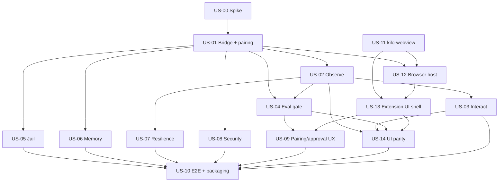

# Delivery plan — Kilo Browser Agent

> Bám spec [0.3.4](../../docs/specs/kilo-browser/README.md) (§1). Mọi trích dẫn § là của spec, không phải của tài liệu này.

## 1. Mục tiêu và nguyên tắc

Mục tiêu: giao `packages/kilo-browser` (§15) đủ 12 tool (§9), extension MV3 (§8.3), chat/settings tái dùng qua `packages/kilo-webview` (§22), guard/jail (§8.4, §12), và bằng chứng AC-01..AC-28 (§18) qua năm mốc M1–M5, sau cổng spike M0.

Nguyên tắc:

- **Vertical slice**: mỗi US cắt qua đủ bridge → shim → extension/UI → test cho một nhóm AC, không làm "tầng" ngang.
- **Protocol freeze sau US-01**: bảng method/tên tool ở §8.2.1 và §10.2 là hợp đồng đóng băng; thay đổi sau đó đi qua §11.
- **Không mở rộng scope ngoài spec**: non-goals ở §4.3 là hàng rào; đề xuất mới ghi thành OQ (§21), không thành task.
- **Không sửa shared opencode**: code mới nằm trong các package `kilo-*` (§15, A12). Extraction `kilo-webview` từ `kilo-vscode/webview-ui` là refactor được phép (A13) với điều kiện visual/unit của `kilo-vscode` không đổi.
- **Ranh giới UI**: `kilo-webview` không import `vscode`, `kilo-vscode`, `chrome.*`; host-specific nằm ở adapter (`VSCodeProvider`, `BrowserHostBridge`).
- **Bằng chứng trước tuyên bố**: chỉ tick checklist khi lệnh kiểm chứng đã chạy và pass ([todo.md](./todo.md)).

## 2. Phạm vi và non-goals

Trong phạm vi: bridge + shim + extension MV3 + `kilo-webview` + host adapter + guard + workspace `.kilo/kilo-browser/` + artifacts/log + test, parity gate và packaging beta (§2, §15, §22).

Ngoài phạm vi, theo [README §4.3](../../docs/specs/kilo-browser/README.md):

| Non-goal | Hệ quả cho plan |
|---|---|
| Agent/LLM trong extension | Không có task suy luận phía extension |
| Nhiều tab đồng thời trong v1 | Một `tabId`; đổi tab = detach/attach (§8.3.7) |
| Headless CI không Chrome | E2E dùng Playwright persistent context (§17.3), không headless |
| Thay `chrome-devtools-mcp` | Chỉ 12 tool §9 |
| Đọc/ghi ngoài workspace trừ `extraRoots` | Jail là điều kiện qua M2 |
| Đồng bộ memory lên cloud | Không có task backend |
| Firefox/Safari | CDP-only, Chromium 116+ (§8.3.1) |
| Agent Manager, marketplace, terminal/worktree/PR, migration, speech-to-text | Ẩn bằng capability flag (§22.1), không dựng lại trong v1 |
| Tự commit git | Không có task git automation |

## 3. Dependency graph

## 4. Wave và file ownership

Quy tắc cứng: **trong cùng một wave, không hai US nào sở hữu cùng một file**. Nếu overlap không tránh được thì serialize hoặc tách theo module đã có trong layout §15/§22. Chuyển giao file chỉ xảy ra **giữa các wave** (cột "handoff") hoặc theo annotation `(handoff từ ...)` / `(handoff cho ...)`.

| Wave | US song song | File ownership (exclusive) | Elapsed | Handoff / ghi chú |
|---|---|---|---|---|
| W0 | US-00 | `test/fixture/app/**` | 1,5 | Fixture có login/Save bug/API 500/console error (§17.3); handoff cho US-10 |
| W1 | US-01, US-11 | US-01: `package.json`, `tsconfig.json`, `src/cli.ts`, `src/index.ts`, `src/mcp.ts`, `src/bridge/{server,http,ws,kilo,lifecycle,sse}.ts`, `src/protocol/{version,rpc}.ts`, `src/config/{schema,load,generate}.ts`, `extension/manifest.json`, `extension/src/background/service-worker.ts`, `extension/src/transport/ws.ts` · US-11: `packages/kilo-webview/**`, `packages/kilo-vscode/webview-ui/src/**` (di chuyển/import), `packages/kilo-vscode/esbuild.js`, tsconfig/knip/storybook configs | 6,5 | US-01 freeze protocol 1.0; `ws.ts`/`lifecycle.ts` handoff cho US-07, `manifest.json` handoff cho US-13, `package.json` handoff cho US-10. US-11 handoff shared UI cho US-09/12/13/14 |
| W2 | US-02, US-05, US-06, US-08, US-12 | US-02: `extension/src/cdp/**`, `extension/src/tools/{status,navigate,snapshot,screenshot,console,network}.ts`, `extension/src/refs/registry.ts`, `extension/src/buffers/ring.ts`, `src/artifacts/{store,naming}.ts`, `test/unit/{refs,buffers}` · US-05: `src/policy/{jail,origin}.ts`, `src/plugin/{kilo-browser-guard,paths}.ts`, `test/unit/jail/**`, `test/e2e/jail/**` · US-06: `src/bridge/memory.ts`, `src/templates/**`, `test/unit/templates/**` · US-08: `src/policy/redact.ts`, `src/log/jsonl.ts`, `test/unit/redact/**` · US-12: `src/host/**`, `src/bridge/ui-*.ts`, `extension/src/ui-port.ts` | 6,5 | Năm cây file rời nhau; `cdp/session.ts` handoff cho US-07, `refs/registry.ts` handoff cho US-03; guard plugin handoff cho US-04; US-12 dùng `kilo-webview` types từ US-11 |
| W3 | US-03, US-04, US-07, US-13 | US-03: `extension/src/tools/{click,type,press,reload,wait_for}.ts`, `extension/src/cdp/domains/input.ts`, `extension/src/refs/registry.ts` (handoff từ US-02) · US-04: `extension/src/tools/eval.ts`, `extension/src/approval/**`, `src/plugin/eval.ts`, `src/config/schema.ts` (eval key, handoff từ US-01), `src/plugin/kilo-browser-guard.ts` (handoff từ US-05) · US-07: `src/bridge/{supervisor,ws,lifecycle}.ts` (handoff từ US-01), `extension/src/transport/ws.ts` (handoff từ US-01), `extension/src/cdp/session.ts` (handoff từ US-02), `test/integration/restart/**` · US-13: `extension/vite.config.ts`, `extension/ui/{index.html,settings.html,bootstrap.ts,main.tsx}`, `extension/manifest.json` (handoff từ US-01) | 3,5 | Bốn cây file rời nhau; US-13 chỉ dựng vỏ + CSP, không sở hữu `extension/ui/features/**` |
| W4 | US-09, US-14 | US-09: `extension/ui/pairing/**`, `extension/ui/connection/**`, `extension/ui/approval/**` · US-14: `extension/ui/features/**`, `extension/ui/file-viewer/**`, `extension/ui/diff-viewer/**`, `extension/ui/capabilities.ts` | 4,5 | Hai cây file rời nhau; US-09 đọc approval contract từ US-04 và shell từ US-13; US-14 dùng host adapter US-12 và component `kilo-webview` US-11 |
| W5 | US-10 | `test/e2e/ui/**` và `test/e2e/**` còn lại (trừ `test/e2e/jail/**`), `test/fixture/app/**` (handoff từ US-00), `build.ts`, `extension/build.ts`, `package.json` (handoff từ US-01), docs + changeset | 4,5 | Chỉ chạy khi W2–W4 đã merge; `test/e2e/jail/**` thuộc US-05 |

## 5. Critical path và tổng ước lượng

Ước lượng lấy nguyên giá trị trong metadata từng US file.

**Tuần tự** (cộng toàn bộ midpoint):

`1,5 + 4,5 + 3,5 + 3,5 + 2,5 + 3,5 + 2 + 3 + 2 + 2,5 + 4,5 + 6,5 + 6,5 + 3,5 + 4,5 = 54 ngày` (khoảng 48–60 ngày)

**Song song** (elapsed theo wave, lấy US dài nhất trong wave):

`W0 1,5 + W1 6,5 + W2 6,5 + W3 3,5 + W4 4,5 + W5 4,5 = 27 ngày` (khoảng 24–30 ngày)

**Critical path**: US-00 → US-01 → US-12 → US-13 → US-14 → US-10

`1,5 + 4,5 + 6,5 + 3,5 + 4,5 + 4,5 = 25 ngày`

Elapsed là 27 ngày vì W1 và W2 mỗi wave dài 6,5 ngày (US-11 và US-12 là US dài nhất), trong khi nhánh critical path chỉ cần 4,5 ngày cho US-01 ở W1.

## 6. AC coverage matrix

Mỗi AC-01..AC-28 xuất hiện ít nhất một lần (§18). AC-01, AC-11, AC-16 có thêm US-09 làm secondary. Cột "Mốc" là mốc gate phải pass; US milestone trong README/§4 có thể sớm hơn (US-02 ở M1 nhưng AC-04..08 gate ở M2; US-03/US-04 ở M2 nhưng AC-09..12 gate ở M3).

| AC | Primary US | Secondary | Mốc | Spec |
|---|---|---|---|---|
| AC-01 | US-01 | US-09 | M1 | §18 |
| AC-02 | US-01 | — | M1 | §18 |
| AC-03 | US-01 | — | M1 | §18 |
| AC-04 | US-02 | — | M2 | §18 |
| AC-05 | US-02 | — | M2 | §18 |
| AC-06 | US-02 | — | M2 | §18 |
| AC-07 | US-02 | — | M2 | §18 |
| AC-08 | US-02 | — | M2 | §18 |
| AC-09 | US-03 | — | M3 | §18 |
| AC-10 | US-04 | — | M3 | §18 |
| AC-11 | US-04 | US-09 | M3 | §18 |
| AC-12 | US-03 | — | M3 | §18 |
| AC-13 | US-05 | — | M2 | §18 |
| AC-14 | US-05 | — | M2 | §18 |
| AC-15 | US-07 | — | M3 | §18 |
| AC-16 | US-07 | US-09 | M3 | §18 |
| AC-17 | US-08 | — | M2 | §18 |
| AC-18 | US-06 | — | M2 | §18 |
| AC-19 | US-05 | — | M2 | §18 |
| AC-20 | US-10 | — | M5 | §18 |
| AC-21 | US-09 | — | M4 | §18 |
| AC-22 | US-14 | — | M4 | §18 |
| AC-23 | US-14 | — | M4 | §18 |
| AC-24 | US-09 | — | M4 | §18 |
| AC-25 | US-14 | — | M4 | §18 |
| AC-26 | US-14 | — | M4 | §18 |
| AC-27 | US-13 | — | M3 | §18 |
| AC-28 | US-11 | — | M1 | §18 |

## 7. Milestone gates

Điều kiện qua mốc chung (§19): không test bị skip, không tăng timeout để che lỗi, typecheck sạch.

| Mốc | Entry | Exit | Lệnh | AC phải pass |
|---|---|---|---|---|
| M0 | Spec 0.3.3 đọc xong; fixture dựng được | Demo navigate → snapshot → click trên fixture; protocol notes cho US-01 | `bun run demo` (§16) | none (gate demo, §19) |
| M1 | M0 exit; protocol 1.0 chốt theo §8.2.1/§10.2 | Bridge preflight/spawn/health + pairing; extraction `kilo-webview` + HostBridge; visual baseline | `bun test`, `bun run typecheck`; `bun run test:visual` (baseline) | AC-01..AC-03, AC-28 |
| M2 | M1 exit; protocol đóng băng | 6 tool đọc + 6 tool còn lại, guard, jail, redaction, artifact, memory, browser host adapter | `bun test`, `bun run typecheck`; jail unit trên 3 OS (§17.4); host adapter test | AC-04..AC-08, AC-13, AC-14, AC-17..AC-19 (host adapter: no primary AC) |
| M3 | M2 exit | Interact/eval/resilience + extension UI shell (Vite/MV3/CSP) | `bun test test/e2e`; CSP/asset smoke (`bun run test:ui` shell) | AC-09..AC-12, AC-15, AC-16, AC-27 |
| M4 | M3 exit | UI parity chat/settings/session/history + pairing/approval UX | `bun run test:ui`; capability checks | AC-21..AC-26 (AC-01/AC-11/AC-16 secondary) |
| M5 | M4 exit | E2E UI đầy đủ, packaging (`build.ts` + Vite), docs, beta; chưa publish store | `bun run build`, `bun run build:extension`, `bun run build:ui` reproducible; `bun run test:visual`; full suite | AC-20 chạy lại + full suite |

## 8. Quality gate cho mọi US

Áp dụng cho từng US trước khi tick "AC verified":

| Gate | Cách kiểm |
|---|---|
| Typecheck | `bun run typecheck` từ package tương ứng (§16) đúng `tsgo --noEmit` |
| Targeted test | `bun test <path>` cho vùng US chạm; không chạy `bun test` từ root (§16) |
| VS Code visual regression | `bun run test:visual` trong `packages/kilo-vscode/`; snapshot không đổi sau extraction |
| Extension UI E2E | `bun run test:ui` trong `packages/kilo-browser/`; chat stream, settings save, PermissionDock |
| Shared import audit | `kilo-webview` không import `vscode`, `kilo-vscode`, `chrome.*` |
| Bundle budget | `bun run build:ui`; chat ≤ 4,5 MB gzip, settings ≤ 3,0 MB gzip |
| Không skipped test | Không `.skip`/`.todo` không lý do; skip hợp lệ phải ghi lý do (§17.4) |
| Không tăng timeout | Timeout theo bảng §9 và §8.2.6, không nới để test xanh |
| Không `any` | Theo chuẩn repo |
| Không empty catch | Theo chuẩn repo; lỗi phải xử lý hoặc log |
| `kilocode_change` | Không áp dụng — code nằm trong package `kilo-*`; sửa `kilo-vscode/webview-ui` chỉ trong phạm vi extraction |
| Changeset | Chỉ bắt buộc ở M5 theo §15 |
| Docs | US file + `plan.md`/`todo.md` nếu contract lệch |

## 9. Definition of Ready / Done

**Ready** (trước khi bắt đầu US):

- [ ] US file nêu contract input/output/error, trích § tương ứng (không tự đặt route/key mới).
- [ ] AC ánh xạ ở §6 và lệnh kiểm chứng cụ thể đã ghi.
- [ ] Phụ thuộc đã merge và nằm ở wave trước.
- [ ] File ownership không trùng US khác trong cùng wave.
- [ ] Fixture/route cần dùng đã tồn tại (từ W0).
- [ ] Với US UI: capability list và surface bị ẩn đã khai báo trước khi code.

**Done** (trước khi tick US):

- [ ] Toàn bộ checklist chi tiết trong US file đã pass, **và** 5 ô roll-up trong [todo.md](./todo.md) (contract, implementation, tests, docs, AC verified) đã tick kèm bằng chứng.
- [ ] Quality gate §8 pass.
- [ ] Bằng chứng AC (log, artifact, output lệnh) lưu trong US file.
- [ ] Không phát sinh file ngoài ownership đã gán.
- [ ] Không có VS Code visual regression diff sau extraction; `bun run test:visual` xanh.
- [ ] Capability hides đã kiểm: surface tắt không render, không có nút chết.

## 10. Rủi ro làm đổi plan

| Rủi ro | Ảnh hưởng plan | US hấp thụ | Dấu hiệu sớm |
|---|---|---|---|
| Protocol churn sau freeze | W2–W5 phải chạy lại contract; AC-01..AC-12 rủi ro | US-01 giữ freeze; mọi thay đổi qua §11 và US-10 verify lại | Method/tên tool lệch §8.2.1 |
| MV3 SW bị suspend làm rơi WS (§20) | W3 kéo dài; AC-15 và AC-21 rủi ro | US-07 (`chrome.alarms` + reconnect, §8.3.7) | `ws.close` > 3 lần/10 phút |
| DevTools chiếm debugger (§20) | AC-16 + UX M4 trượt | US-07 phát hiện, US-09 hiển thị hướng dẫn (§8.3.3, §8.3.11) | `DEVTOOLS_CONFLICT` > 2% tool call |
| Jail Windows bị lách bởi junction/UNC (§20) | M2 không qua; AC-13/AC-14 | US-05 (realpath + test matrix, §8.4.1, §17.4) | `jail.deny` thấp bất thường |
| Chrome Web Store review chậm (§20, OQ-4) | M5 không publish được | US-10 chuyển sang sideload beta | Review > 2 tuần |
| Bridge chết để lại `kilo serve` mồ côi (§20) | M3 reconnect không sạch | US-07 watchdog + kill tree (§8.1.4) | `kilo serve` sống sau bridge exit |
| Redaction bỏ sót secret (§20) | AC-17 trượt, release chặn | US-08 nhiều lớp + audit ở §12 | Audit artifact thấy token |
| Prompt injection từ trang (§20) | AC-10/AC-11 và UX rủi ro | US-04 deny mặc định + approval; US-09 UI | Model click/type ngoài mục tiêu |
| Port/loopback bị chiếm (§20) | M1 pairing flaky | US-01 port 0 + health + token (§8.1.2) | `EADDRINUSE`, 401 hàng loạt |
| Extraction `kilo-webview` làm hỏng VS Code UI (§22.11) | M1 trượt; parity M4 không đáng tin | US-11 codemod + visual regression trước merge | Snapshot diff > 0 |
| Message contract drift giữa UI và bridge (§22.11) | W3/W4 phải sửa hai phía | US-11 shared types; US-12 compile gate + envelope version | Typecheck fail ở extension |
| CSP/worker Shiki fail trong MV3 (§22.11) | AC-22/AC-27 trượt | US-13 CSP + worker asset; US-14 Shiki shared | CSP violation trong console |
| Bundle UI quá lớn (§22.11) | M5 không đạt budget | US-14 code split theo page; US-10 CI budget | Vượt 4,5 MB chat |
| Critical path 25 ngày, elapsed 27; W1/W2 mỗi wave 6,5 ngày | Trượt M3/M4 nếu W1/W2 trễ | US-11 chạy song song W1; US-12 giữ W2; US-14 giữ W4 | W1/W2 trễ > 1 ngày |

## 11. Change control

1. Mọi thay đổi spec phải sửa spec trước: tăng version + changelog ở [README §1](../../docs/specs/kilo-browser/README.md), kèm mục bị ảnh hưởng.
2. Xác định US bị ảnh hưởng bằng AC matrix §6 và file ownership §4.
3. Cập nhật checklist của US đó trong [todo.md](./todo.md) **trước khi** viết code; nếu đổi dependency/wave, sửa `plan.md` cùng lúc.
4. Protocol change sau freeze: bump `protocolVersion` theo §10.6, thêm test version ở §17.1, và thêm bước verify vào US-10.
5. Thay đổi HostBridge/message contract sau M1: bump envelope version, thêm test typecheck + `bun run test:ui` vào US-12/US-13.
6. Không nhận thay đổi chỉ tồn tại trong chat; phải nằm trong spec hoặc US file.

## 12. Release checklist beta

| Bước | Điều kiện pass |
|---|---|
| Build | `bun run build`, `bun run build:extension`, `bun run build:ui` reproducible (§16, AC-20) |
| Load unpacked | Chrome/Edge 116+ load `extension/dist`, pair được với bridge (§8.3.1, §8.3.9) |
| Browser UI smoke | Chat stream, Settings mở/save, theme light/dark/system; Shiki worker load, 0 CSP violation (§22.7–§22.10) |
| Visual parity | `bun run test:visual` xanh; không snapshot diff sau extraction (§22.10) |
| Manual loop | 6 mục §17.5 pass trên fixture |
| Redaction audit | Quét artifact/log mẫu, không có token/cookie/password (§12.5) |
| Docs | Runbook start/pair/attach, known issues = OQ-1..OQ-7 (§21) |
| Changeset | Có changeset theo §15 nếu publish; `private:true` thì ghi rõ |
| Rollback | `kilo-browser pair --rotate` (§12.2), unload extension, dừng bridge; `runtime.json` bị xóa khi shutdown (§8.1.9) |

## 13. Trạng thái triển khai

Đối chiếu spec 0.3.3 ([README](../../docs/specs/kilo-browser/README.md), [§22.12](../../docs/specs/kilo-browser/12-ui.md)). Ước lượng ở §5 giữ nguyên; cột dưới đây là thực tế đã giao.

**Review pass (0.3.3):** review trên các thay đổi chưa commit đã đóng 4 mục CRITICAL cùng các WARNING/SUGGESTION; nhóm sửa: security, reliability, packaging, performance, dead code. Ước lượng §5 và cột trạng thái US giữ nguyên (US-11 vẫn partial).

| US | Ước lượng (ngày) | Trạng thái | Ghi chú / deviation |
|---|---|---|---|
| US-00 | 1,5 | complete | Fixture + `src/demo.ts`; gate `bun run demo` chưa có kết quả trong báo cáo (chưa xác nhận). |
| US-01 | 4,5 | complete | Bridge preflight/supervisor/HTTP/tool WS/UI WS/pairing claim/SSE relay/host RPC/approval gate. |
| US-02 | 3,5 | complete | Tool quan sát + refs/buffers/artifacts. |
| US-03 | 3,5 | complete | Tool tương tác + verify (stale-ref). |
| US-04 | 2,5 | complete | Eval gate + approval. |
| US-05 | 3,5 | complete | Jail/origin + guard plugin. |
| US-06 | 2 | complete | Memory + session templates. |
| US-07 | 3 | complete | Supervisor/keepalive/reconnect. |
| US-08 | 2 | complete | Redaction + JSONL log. |
| US-09 | 2,5 | complete | Pairing/connection/approval UX trong UI tái dùng. |
| US-10 | 4,5 | complete | `bun test` 171/0; `bun run test:e2e` 7/7; `bun run build`, `build:ui`, `build:extension` pass (theo báo cáo triển khai). |
| US-11 | 6,5 | partial | Host seam trong `kilo-vscode/webview-ui` đã giao; **còn lại**: tách vật lý `packages/kilo-webview` (move `components`/`context` portable/`hooks`/`i18n`/`styles`/`types/messages`/`utils`), codemod `useVSCode()`→`useHost()` (~70 call site), import audit tự động, baseline visual regression (deviation (a)). |
| US-12 | 6,5 | complete | Browser host adapter + host RPC; file/diff/url viewer đã giao (`file.html`/`diff.html` mở qua adapter; bridge `/ui/file`, `/ui/diff`, `/ui/url-guard`); message `openFile`/… vẫn `HOST_UNSUPPORTED` nếu tới bridge `UiHost` (deviation (b)). |
| US-13 | 3,5 | complete | Vite shell, sidepanel/settings, bootstrap; build → `extension/dist/ui-dist`. |
| US-14 | 4,5 | complete | Chat/settings/history/capability + file/diff viewer (`/ui/file`, `/ui/diff`, `/ui/url-guard`; `file.html`/`diff.html`) đã giao. Bằng chứng: `bun run typecheck` exit 0; `bun test` 179 pass/1 skip/0 fail (180 test/45 file); `bun run test:e2e` 8/8; `bun run build:ui` pass. Còn `HOST_UNSUPPORTED`: login/logout, cloud, Agent Manager, marketplace, migration, worktree, terminal, PR, autocomplete, experimental runtime, export/revert/delete message, provider usage (d); `session.diff` chưa emit vào union UI (e); clipboard page-side (c). |
